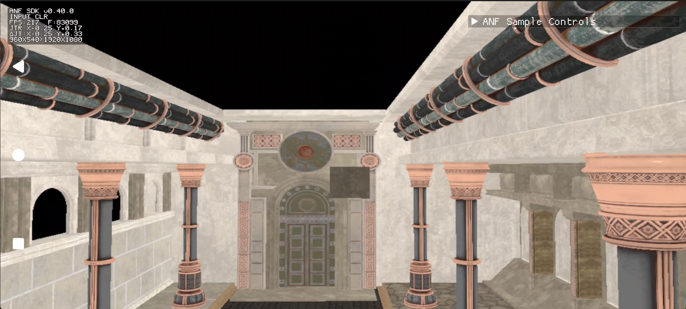
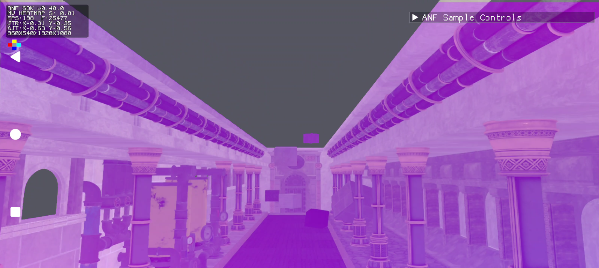
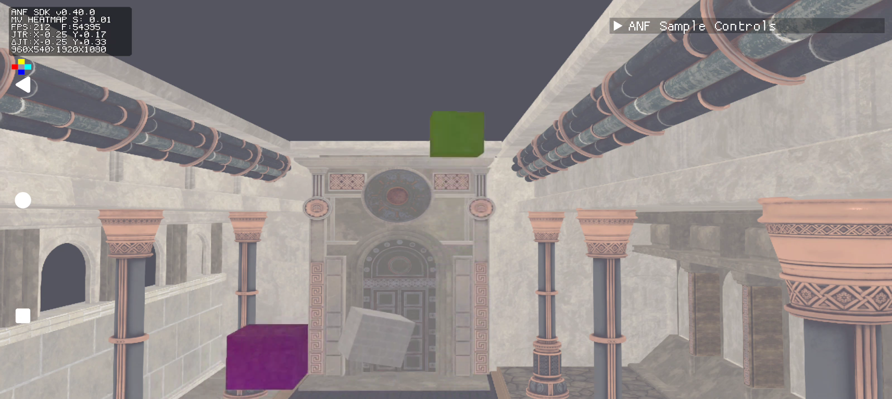
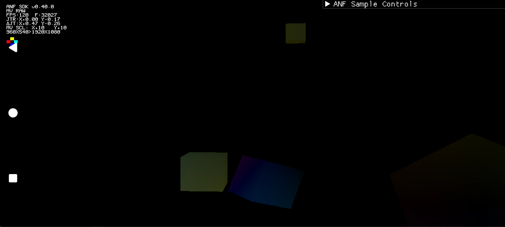
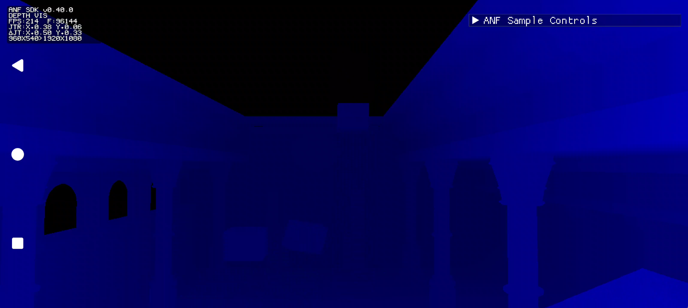
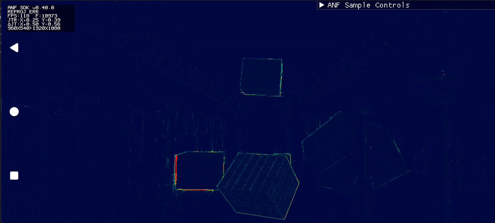
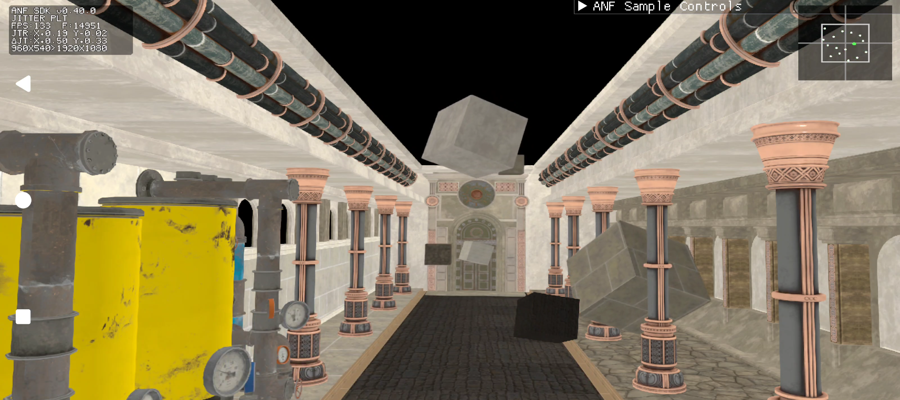

# Adreno™ Neural Fusion (ANF) SDK 调试覆盖层指南

| [English](./DEBUG-OVERLAY.md) | [简体中文](./DEBUG-OVERLAY-zh-CN.md) |
|---|---|

本指南介绍了在将超分辨率 （SR） 集成到 Android Vulkan 渲染器中时如何启用和使用 ANF 调试覆盖层。

覆盖层显示提供给 ANF 的颜色、深度、运动矢量和抖动数据。某些模式通过 SR 输出混合诊断数据。其他模式用输入或派生图像替换显示的输出。覆盖层作为 SR 调度的一部分运行，并在后续的应用通道之前修改输出。

当前覆盖层仅支持 SR。在集成和验证期间使用它，不要将其用作生产环境的 HUD。

## 目录

- [ 开始](#before-you-begin)
之前- [启用覆盖层](#enable-the-overlay)
- [配置 SR 调度](#configure-an-sr-dispatch)
- [HUD](#hud)
- [覆盖层模式](#overlay-modes)
- [验证 SR 集成](#verify-the-sr-integration)
- [诊断 SR 伪影](#diagnose-sr-artifacts)
- [对覆盖层进行故障排除](#troubleshoot-the-overlay)
- [禁用生产覆盖层](#disable-the-overlay-for-production)
- [配置参考](#configuration-reference)
- [相关资源](#related-resources)

## 开始之前

在添加覆盖层之前完成基础 SR 集成。应用程序必须已经创建 ANF 实例和 SR 技术、查询资源要求、准备 SR 资源并以 `AnfSRDispatch` 结构提交 `AnfTechniqueDispatchInfo`。

请记住以下限制：

- 应用程序在创建 ANF 实例时必须启用覆盖层。
- 启用覆盖层可更改 ANF 返回的 Vulkan 图像使用要求。
- SDK 为每个 ANF 实例维护一个覆盖层。同一时间只能有一个技法实例使用该调试覆盖层。
- 更换 SR 技法时，请先销毁现有技法实例，再创建替代技法实例。
- 覆盖层设置将持续存在，直到应用程序提交另一个 `AnfDebugOverlayConfig`。
- 输入和输出资源必须保持有效，直到调度完成。
- 每帧资源缓冲必须支持用于创建技术的 `maxInFlight` 值。

覆盖层在后续渲染通道之前写入 SR 输出。色调映射、颜色分级、锐化、泛光、胶片颗粒和 UI 合成可能会修改或覆盖该覆盖层。如果覆盖层显示为有色、变暗或部分隐藏，则检查消耗 SR 输出的通道。

## 启用覆盖层

### 1. 设置实例标志

在创建 ANF 实例之前添加 `ANF_INSTANCE_CREATE_FLAG_ENABLE_DEBUG_OVERLAY`。使用 `|=` 使应用程序保留任何其他实例标志。

```cpp
AnfInstanceCreateInfo instanceInfo = {};
instanceInfo.header.type           = ANF_STYPE_INSTANCE_CREATE_INFO;
instanceInfo.clientApi             = ANF_CLIENT_API_VULKAN;
instanceInfo.flags                |=
    ANF_INSTANCE_CREATE_FLAG_ENABLE_DEBUG_OVERLAY;

AnfInstance anfInstance = {};
AnfResult result = anf.CreateInstance(&instanceInfo, &anfInstance);
if (result != ANF_RESULT_SUCCESS)
{
    // Stop ANF initialization and use the application's fallback path.
}
```

应用程序无法在现有实例上启用覆盖层。如果没有标记，则后续 `AnfDebugOverlayConfig` 结构不会启用覆盖层渲染。

当没有标记时，ANF 不会创建覆盖层，并且没有每帧覆盖层成本。

### 2. 根据查询的要求创建资源

启用覆盖层会将 Vulkan 使用标志添加到 ANF 返回的资源要求中。

| 资源标签 | 其他 Vulkan 使用 |
|---|---|
| `ANF_RESOURCE_LABEL_OUTPUT_COLOR` | `VK_IMAGE_USAGE_STORAGE_BIT \| VK_IMAGE_USAGE_TRANSFER_SRC_BIT` |
| `ANF_RESOURCE_LABEL_INPUT_COLOR` | `VK_IMAGE_USAGE_SAMPLED_BIT` |
| `ANF_RESOURCE_LABEL_MOTION_VECTORS` | `VK_IMAGE_USAGE_SAMPLED_BIT` |
| `ANF_RESOURCE_LABEL_DEPTH` | `VK_IMAGE_USAGE_SAMPLED_BIT` |

根据查询要求创建图像的应用程序会接收这些标记，作为正常设置的一部分。硬编码使用标志的应用程序必须在创建图像之前添加它们。创建图像后，无法更改 Vulkan 图像使用情况。

使用资源要求返回的格式创建 `ANF_RESOURCE_LABEL_OUTPUT_COLOR`。不要采用一种固定的输出格式。

## 配置 SR 调度

初始化 `AnfDebugOverlayConfig`，选择模式，并将结构链接到 `AnfSRDispatch::header.pNext`。继续提交正常 `AnfTechniqueDispatchInfo`。

```cpp
AnfDebugOverlayConfig overlayConfig = {};
overlayConfig.header.type           = ANF_STYPE_DEBUG_OVERLAY_CONFIG;
overlayConfig.mode                  = ANF_DEBUG_OVERLAY_MODE_MV_HEATMAP;
overlayConfig.mvHeatmapScale        = 0.1f;
overlayConfig.hudCorner             =
    ANF_DEBUG_OVERLAY_HUD_CORNER_TOP_RIGHT;

overlayConfig.header.pNext = srDispatch.header.pNext;
srDispatch.header.pNext    = &overlayConfig.header;

dispatchInfo.pTechniqueGroupDispatchInfo = &srDispatch.header;

AnfResult result = anf.DispatchTechnique(srTechnique, &dispatchInfo);
if (result != ANF_RESULT_SUCCESS)
{
    // Handle the dispatch failure before using the output.
}
```

配置是有状态的。在 ANF 接受配置后，如果缺少 `AnfDebugOverlayConfig`，稍后的调度会保留这些设置。只有当值发生变化时，才重新链接结构。

要停止绘制，请提交一次配置，并将 `mode` 设置为 `ANF_DEBUG_OVERLAY_MODE_NONE`。

```cpp
overlayConfig.mode = ANF_DEBUG_OVERLAY_MODE_NONE;
```

多帧模式在活动时保留其历史记录。

若集成需要实时检查，可将模式选择和配置修改连接到应用程序的调试控件。随下一个 SR 调度提交的配置对该调度生效。

## HUD

每个活动模式都显示具有当前覆盖层状态的 HUD。HUD 报告 SDK 版本、活动模式、帧定时、帧计数、当前抖动、抖动变化以及 SR 输入和输出尺寸。当控件取值与默认值不同时，将显示各模式专属行。

| HUD 行 | 条件 |
|---|---|
| `MV SCL:X+1.00 Y-1.00` | 在运动矢量模式中，`mvValueScale` 不同于 `{1.0, 1.0}` |
| `JTR SCL:X+2.00 Y-1.00` | 在SR 抖动标度模式中，`jitterScale` 不同于 `{1.0, 1.0}` |
| `DEPTH SCL:10` | 在深度可视化模式中，`depthScale` 不同于 `1` |
| `JTR SIGN:X+ Y-` | 抖动累积模式处于活动状态 |

`hudCorner` 设置为以下值之一：

- `ANF_DEBUG_OVERLAY_HUD_CORNER_TOP_LEFT`
- `ANF_DEBUG_OVERLAY_HUD_CORNER_TOP_RIGHT`
- `ANF_DEBUG_OVERLAY_HUD_CORNER_BOTTOM_LEFT`
- `ANF_DEBUG_OVERLAY_HUD_CORNER_BOTTOM_RIGHT`

如果渲染器由于渲染目标使用倒 Y 轴而倒置显示 HUD，则设置 `hudFlipY = ANF_TRUE`。这只会更改 HUD 方向。它不会更改可视化数据。

## 覆盖层模式

下表总结了 `AnfDebugOverlayMode` 中的值。

| 模式 | 用途 | 主要控制 |
|---|---|---|
| `ANF_DEBUG_OVERLAY_MODE_NONE` | 停止覆盖层绘制 | 无 |
| `ANF_DEBUG_OVERLAY_MODE_INPUT_COLOR` | 显示经双线性放大的SR输入颜色 | 无 |
| `ANF_DEBUG_OVERLAY_MODE_MV_HEATMAP` | 检查运动矢量方向和幅度 | `mvHeatmapScale`, `showRawMv`, `mvValueScale` |
| `ANF_DEBUG_OVERLAY_MODE_DEPTH_VIS` | 将深度缓冲区作为色阶进行查看 | `depthInvert`, `depthScale` |
| `ANF_DEBUG_OVERLAY_MODE_WARP_PREDICT` | 使用当前运动矢量对上一帧 SR 输出进行重映射 | `mvValueScale` |
| `ANF_DEBUG_OVERLAY_MODE_REPROJECT_ERROR` | 显示运动矢量预测错误 | `mvValueScale` |
| `ANF_DEBUG_OVERLAY_MODE_JITTER_PLOT` | 绘制最近的抖动偏移 | 无 |
| `ANF_DEBUG_OVERLAY_MODE_JITTER_ACCUMULATE` | 检查子像素覆盖率和抖动符号 | `jitterAccumAlpha`, `jitterScale` |
| `ANF_DEBUG_OVERLAY_MODE_SR_JITTER_SCALE` | 将 `jitterScale` 应用于 SR 使用的抖动 | `jitterScale` |

### 输入颜色

`ANF_DEBUG_OVERLAY_MODE_INPUT_COLOR` 显示经双线性放大至 SR 输出尺寸后的 SR 输入颜色。它会替换显示的 SR 输出，但 SR 调度仍然运行。

<table align="center" width="760">
  <tr>
    <td align="center">
      
      <br>
      <small><em>输入颜色模式显示经双线性放大后的带抖动 SR 输入。</em></small>
    </td>
  </tr>
</table>

使用此模式确认 ANF 接收预期的彩色图像、格式和尺寸。正确的结果是将可识别的低分辨率场景缩放到输出大小。投影抖动会产生轻微的移动或柔和感，因为该模式仅显示一帧经过抖动的输入帧，而未进行时域重建。

检查以下问题：

- 黑色或纯色输出可能表示资源句柄或布局不正确。
- 严重色偏或通道互换可能表示格式不匹配。
- 接缝、裁剪或部分内容可能表示尺寸不正确。

使用抖动模式验证抖动。输入颜色模式不会消除投影抖动。

### 运动矢量热图

`ANF_DEBUG_OVERLAY_MODE_MV_HEATMAP` 显示运动矢量方向和幅度。默认视图将热图混合叠加在 SR 输出之上。将 `showRawMv = ANF_TRUE` 设置为用原始方向着色视图替换它。

混合热图使用色调表示方向，使用亮度表示大小。运动量小的像素使用灰蓝色。

| 方向 | 热图颜色 |
|---|---|
| 向右，正 X 轴 | 青色 |
| 向左，负 X 轴 | 红色或品红色 |
| 向下，正 Y 轴 | 蓝色或紫色 |
| 向上，负 Y 轴 | 黄色或绿色 |
| 极少运动或无运动 | 灰蓝色 |

原始视图使用黑色表示无运动，使用完全不透明表示矢量场。

| 方向 | 原始视图颜色 |
|---|---|
| 向右，正 X 轴 | 青色 |
| 向左，负 X 轴 | 红色 |
| 向下，正 Y 轴 | 蓝色 |
| 向上，负 Y 轴 | 黄色 |
| 无运动 | 黑色 |

<table align="center" width="100%">
  <tr>
    <td align="center" width="50%">
      
      <br>
      <small><em>整个场景的混合热图。</em></small>
    </td>
    <td align="center" width="50%">
      
      <br>
      <small><em>混合热图与不同的对象运动。</em></small>
    </td>
  </tr>
</table>

HUD 显示两个视图的颜色键。键随 `hudCorner` 移动并跟随 `hudFlipY`。

使用受控的摄像头平移检查结果。大部分静态几何体在平移过程中应呈现一致方向。除了动画对象外，静止摄像头应产生很少的运动。

检查以下问题：

- 平滑运动期间的噪声或斑点可能表示运动矢量生成不正确或资源错误。
- 与预期的摄像机运动相反的方向可能表示轴符号不匹配。
- 运动时出现全黑画面，可能表示存在零矢量，或者刻度相对于实际运动来说太大了。
- 静态场景上的完全饱和，可能表示存在无效矢量或刻度太小。

`mvHeatmapScale` 控制混合热图中的显示灵敏度。数值越低，小动作越明显。数值越高，就需要越大的运动量才能达到完全饱和。此字段不会更改诊断扭曲模式使用的运动矢量。

当场景颜色使混合热图难以解释时，启用原始视图。下面的示例还应用了 10 倍运动矢量值标度，因此较小的矢量更容易在黑色背景上进行检测。

<table align="center" width="760">
  <tr>
    <td align="center">
      
      <br>
      <small><em>具有 10× 值刻度的原始运动矢量视图。</em></small>
    </td>
  </tr>
</table>

`mvValueScale` 乘以每个轴的运动矢量值。在轴上使用 `-1.0` 测试符号不匹配。对此字段的更改会影响运动矢量热图、重映射预测和重新投影错误。

### 深度可视化

`ANF_DEBUG_OVERLAY_MODE_DEPTH_VIS` 将显示的 SR 输出替换为由深度缓冲区生成的颜色渐变条。

<table align="center" width="760">
  <tr>
    <td align="center">
      
      <br>
      <small><em>深度可视化揭示场景边界和提供的深度分布。</em></small>
    </td>
  </tr>
</table>

默认渐变条将较大数值解读为更近的几何体。近值显示为黑色或深蓝色。中值在蓝色和紫色之间移动。远值在粉色到白色之间移动。

寻找清晰的物体边界和连续表面的平滑梯度。检查以下问题：

- 全黑视图可能表示可视化需要相反的深度惯例。将 `depthInvert = ANF_TRUE` 设置为检查反转后的值。
- 全白画面可能表示深度图像未写入，或数值集中在远平面。
- 可见色阶跳变可能代表深度精度不足。
- 平坦表面上的噪音可能表示存在格式或资源问题。

`depthInvert` 更改可视化。在更改渲染器或 ANF 集成之前，使用结果了解所提供的深度惯例。

`depthScale` 在颜色映射之前对深度值进行乘法运算。当有效深度值占据窄范围且默认视图未显示足够的间距时，增大该值。

### 重映射预测

`ANF_DEBUG_OVERLAY_MODE_WARP_PREDICT` 用当前运动矢量扭曲先前的 SR 输出，并用该预测替换所显示的输出。

正确的运动矢量生成接近当前帧的图像。轮廓边缘与新暴露区域附近出现一定拉伸属于正常现象，因为前一帧不存在被遮挡像素的数据。

检查以下问题：

- 全帧偏移可能表示运动矢量比例或坐标空间错误。
- 与当前摄像机移动相反的运动可能表示倒置符号。
- 大区域涂片可能表示矢量幅度过大。
- 移动表面上的旧图像内容可能表示运动矢量陈旧或缺失。

启用此模式后的第一帧显示当前 SR 输出，而叠加层捕获下一个预测所需的先前输出。

### 重新投影错误

`ANF_DEBUG_OVERLAY_MODE_REPROJECT_ERROR` 用当前运动矢量扭曲先前的 SR 输出，并将预测与当前 SR 输出进行比较。它将 Rec. 709 亮度差映射到颜色斜坡。

| 颜色 | 近似亮度误差 | 解释 |
|---|---:|---|
| 蓝色 | 0% | 预测结果非常接近 |
| 青色 | 5% | 小错误 |
| 绿色 | 10% | 中度错误 |
| 黄色 | 15% | 大错误 |
| 红色 | 20% 或以上 | 最大显示错误 |

<table align="center" width="760">
  <tr>
    <td align="center">
      
      <br>
      <small><em>移动边缘和被遮挡区域周围的再投影误差最强。</em></small>
    </td>
  </tr>
</table>

在摄像机或对象移动期间，正确的矢量应保持大多数连续表面为蓝色。轮廓、遮挡释放区域以及薄几何体处出现较大误差属于预期情况。

检查以下问题：

- 平坦表面上以恒定速率移动的红色区域可能表示矢量不准确。
- 集中在移动对象一侧的错误可能表示帧时序不匹配。
- 与一个轴对齐的错误可能表示该轴上有符号或刻度问题。
- 带有固定摄像头的红色帧可能表示矢量无效或坐标空间错误。

启用此模式后的第一帧显示当前 SR 输出，而覆盖层捕获用于比较的先前输出。

### 抖动图

`ANF_DEBUG_OVERLAY_MODE_JITTER_PLOT` 显示 64 个最近抖动偏移的散点图。该图为 200 x 200 像素。其中心表示零抖动，其边界标记每个轴上 `-0.5` 至 `+0.5` 像素的推荐范围。

<table align="center" width="760">
  <tr>
    <td align="center">
      
      <br>
      <small><em>抖动图显示建议的子像素边界内的最近偏移。</em></small>
    </td>
  </tr>
</table>

当前采样点为绿色。边界内的历史采样点为白色。边界外的采样点为红色。

使用该曲线图确认抖动逐帧变化并覆盖可用亚像素区域。检查以下问题：

- 一个重复点表示抖动未前进。
- 水平线表示没有 Y 轴变化。
- 垂直线表示无 X 轴变化。
- 集中在一个区域的样本表示覆盖率存在偏差。
- 红色样本表示抖动超出建议范围。

### 抖动累积

`ANF_DEBUG_OVERLAY_MODE_JITTER_ACCUMULATE` 从子像素相位构建持久图像。它使用 `jitterScale` 之后的抖动值的符号来选择四个子像素相位中的一个。在此模式下，`jitterScale` 的量值不影响相位选择。摄像机运动重置累积。

为此检查，使用静态摄像头和静态场景。运动可防止受影响区域稳定累积。

要测试抖动符号：

1. 设置 `mode = ANF_DEBUG_OVERLAY_MODE_JITTER_ACCUMULATE`。
2. 设为 `jitterAccumAlpha = 1.0f` 可获得即时反馈。
3. 保持摄像机静止。
4. 测试下面的标志组合。

| `jitterScale.x` | `jitterScale.y` | 测试 |
|---:|---:|---|
| `+1.0` | `+1.0` | 无轴变化 |
| `-1.0` | `+1.0` | 翻转 X |
| `+1.0` | `-1.0` | 翻转 Y |
| `-1.0` | `-1.0` | 翻转两个轴 |

正确的符号组合在相位填充后产生均匀、清晰的结果。如果某个轴上出现重影或双重细节，通常表示该轴的抖动符号不正确。若所有组合均无法收敛，请通过抖动曲线模式确认抖动序列逐帧发生变化。

选择符号约定后，`jitterAccumAlpha` 设置为较小的值，例如 `0.05f`，以检查逐渐收敛。

### SR 抖动缩放

`ANF_DEBUG_OVERLAY_MODE_SR_JITTER_SCALE` 将 `jitterScale` 应用于提交给 SR 神经调度的抖动。在抖动累积模式后使用该功能，对照常规 SR 结果确认所选符号规则。

将 `jitterScale` 设置为累积期间选择的符号组合。比较摄像机移动期间的 SR 结果和详细的静态几何图形。正确的设置应减少与符号不匹配相关的伪影。

此模式更改 SR 使用的抖动。HUD 继续显示通过 `AnfSRDispatch` 提供的未缩放 `jitterOffset`，并在单独一行上显示当前抖动缩放比例。

## 验证 SR 集成

在初始集成期间按以下顺序运行模式。一次更改一个输入或约定，以便每个结果都有明确的原因。

### 1. 验证资源绑定

- 使用输入颜色模式检查颜色资源、格式和尺寸。
- 使用深度可视化功能检查深度资源与数值分布。

### 2. 验证运动矢量

- 在受控摄像头平移期间使用运动矢量热图。
- 使用原始运动矢量视图检查零点运动和轴方向。
- 使用重映射预测检查运动矢量的符号、幅值和坐标空间。

### 3. 验证运动矢量精度

- 在摄像机移动和对象动画过程中使用重新投影错误。
- 单独检查连续表面与预期遮挡释放区域。

### 4. 验证抖动

- 使用抖动图检查序列移动、范围和分布。
- 使用抖动累积来选择正确的轴符号。
- 使用 SR 抖动缩放，对照 SR 结果确认所选数值。

### 5. 评估正常 SR 输出

将模式设置为 `ANF_DEBUG_OVERLAY_MODE_NONE`。纠正叠加层识别的输入问题后，检查正常输出。

## 诊断 SR 伪影

使用此表根据可见问题选择模式。

| 症状 | 检查 | 覆盖层模式 |
|---|---|---|
| 运动物体上的残影 | 这些对象上的运动矢量缺失或不准确 | 重新投影错误 |
| 快速运动时的涂抹 | 运动矢量量值、符号或坐标空间 | 重映射预测，然后使用运动矢量热图 |
| 静态表面上的闪烁噪点 | 抖动范围和分布 | 抖动图 |
| 软输出 | 抖动符号和子像素覆盖 | 抖动累积 |
| 物体边缘附近的伪影 | 深度不连续区域与预期遮挡释放区域 | 深度可视化和重新投影错误 |
| 黑色或损坏的输出 | 颜色资源、格式、布局和尺寸 | 输入颜色 |
| 无可见运动矢量数据 | 绑定资源与矢量生成 | 运动矢量热图 |
| 整个帧的重投误差高 | 运动矢量坐标空间和帧定时 | 重新投影错误 |
| SR 质量随抖动符号变化 | 端到端抖动约定 | SR 抖动缩放 |

## 对覆盖层进行故障排除

本节中的检查解决了覆盖层本身中的故障。当覆盖层正确渲染但暴露 SR 输入中的问题时，请使用上一节。

### 覆盖层未显示

检查以下项目：

- `AnfInstanceCreateInfo::flags`包括 `ANF_INSTANCE_CREATE_FLAG_ENABLE_DEBUG_OVERLAY`.
- `AnfDebugOverlayConfig::header.type` 是 `ANF_STYPE_DEBUG_OVERLAY_CONFIG`。
- 配置链接到 `AnfSRDispatch::header.pNext`。
- `AnfTechniqueDispatchInfo::pTechniqueGroupDispatchInfo` 指向 `AnfSRDispatch::header`。
- `mode` 不是 `ANF_DEBUG_OVERLAY_MODE_NONE`。
- SR 图像是通过启用叠加层后返回的使用标志创建。
- `ANF_RESOURCE_LABEL_OUTPUT_COLOR` 使用上报格式。

如果应用程序硬编码图像使用并省略了所需的标记，请重新创建受影响的图像。应用程序无法向现有 `VkImage` 添加使用标志。

缺少使用标志可能导致无覆盖层输出、Vulkan 验证错误或调度失败。

### 覆盖层有色、暗淡或隐藏

覆盖层在后续应用通道之前修改 SR 输出。暂时绕过 SR 后运行的后处理和 UI 合成。如果叠加层变得清晰，请逐一恢复各个通道，以找出导致其变化的通道。

此行为并不表示覆盖层数据不良。它反映了应用程序的渲染顺序。

### 覆盖层撕裂或画面错乱

覆盖层读取输入颜色、运动矢量和深度。它还读取或写入输出图像。在调度完成之前，请勿修改或重复使用这些资源。

检查以下同步要求：

- 在立即模式下，重新使用调度资源之前，需等待 ANF 信号量发出信号。在记录模式下，等待包含 ANF 命令的应用程序提交完成。
- 输出消费方等待 ANF 完成。
- 每帧资源为 `AnfTechniqueCreateInfo::maxInFlight` 提供了足够的插槽。
- 图像布局和内存依赖项对于完整调度仍然有效。

当应用程序在 ANF 仍然使用资源时写入资源，可能会出现撕裂、黑带或混合帧区域。

### HUD 倒置

当渲染目标使用倒 Y 轴时设置 `hudFlipY = ANF_TRUE`。此设置仅更改 HUD。

### 删除配置后，覆盖层保持活动状态

通过设计，覆盖层设置仍然存在。向 `mode = ANF_DEBUG_OVERLAY_MODE_NONE` 提交 `AnfDebugOverlayConfig` 一次，以停止绘图。

### 重建技术后，覆盖层停止工作

同一时间只能有一个技法实例使用该实例的调试覆盖层。请先销毁现有技法实例，再创建替代技法实例。如果先创建替代技法实例，覆盖层所有权仍可能保留在随后被销毁的原技法实例上。

## 禁用生产覆盖层

发布前，请从正式版本的实例配置中删除 `ANF_INSTANCE_CREATE_FLAG_ENABLE_DEBUG_OVERLAY`。如果应用程序没有其他需要这些使用标志的理由，请重新创建那些仅仅为覆盖层支持而更改的资源配置。

如果开发构建使覆盖层处于启用状态，则在正常输出评估之前提交 `ANF_DEBUG_OVERLAY_MODE_NONE`。省略 `AnfDebugOverlayConfig` 不会禁用以前选择的模式。

## 配置参考

使用前对 `AnfDebugOverlayConfig` 进行零初始化和设置 `header.type`。仅设置 `mode` 即可为大多数模式生成可用的视图。当测试取决于特定值时，明确设置每个控件。

| 字段 | 类型 | 起始值或范围 | 启用 |
|---|---|---|---|
| `mode` | `AnfDebugOverlayMode` | `ANF_DEBUG_OVERLAY_MODE_NONE` | 选择活动可视化。`ANF_DEBUG_OVERLAY_MODE_NONE` 停止绘制。|
| `mvHeatmapScale` | `float` | 从 `0.1f` 开始；典型调谐范围 `0.01f` 至 `1.0f` | 在运动矢量热图模式下设置热图饱和灵敏度。|
| `showRawMv` | `AnfBool` | `ANF_FALSE` | 选择原始方向彩色运动矢量视图。|
| `mvValueScale` | `AnfFloat2` | 从 `{1.0f, 1.0f}` 开始；典型调谐范围为每轴 `-2.0f` 至 `+2.0f` | 在运动矢量热图、warp 预测和重投影误差模式下，将运动矢量的 X 和 Y 值乘以该系数。使用负值测试轴符号变化。|
| `jitterScale` | `AnfFloat2` | 从 `{1.0f, 1.0f}` 开始；典型调谐范围为每轴 `-2.0f` 至 `+2.0f` | 选择抖动累加模式下的抖动符号，并在 SR 抖动标度模式下标度抖动值。|
| `jitterAccumAlpha` | `float` | 有效范围 `0.0f` 至 `1.0f`；起始于 `0.05f`；`1.0f` 用于即时反馈 | 设置抖动累加模式下的累加混合权重。较小的值会使收敛更加平缓。|
| `hudCorner` | `AnfDebugOverlayHudCorner` | `ANF_DEBUG_OVERLAY_HUD_CORNER_TOP_LEFT` | 选择 HUD 角。|
| `hudFlipY` | `AnfBool` | `ANF_FALSE` | 针对 Y 轴反转的渲染目标，翻转 HUD 文本。|
| `depthInvert` | `AnfBool` | `ANF_FALSE` | 在深度可视化模式下，在颜色映射之前反转深度。|
| `depthScale` | `uint32_t` | `1` 至 `99`；以 `1` 开头 | 在深度可视化模式下，在颜色映射之前对深度值进行乘法运算。|

`mvHeatmapScale` 仅更改热图显示灵敏度。`mvValueScale`更改运动矢量诊断所使用的运动矢量值。

`jitterScale` 在两种抖动模式下具有不同的行为：

| 模式 | 行为 |
|---|---|
| `ANF_DEBUG_OVERLAY_MODE_JITTER_ACCUMULATE` | 使用每个轴的符号。幅度不会改变相位选择。|
| `ANF_DEBUG_OVERLAY_MODE_SR_JITTER_SCALE` | 对 SR 调度所使用的抖动应用符号与幅度。|

## 相关资源

- [Adreno™ Neural Fusion SDK 代码库](https://github.com/SnapdragonGameStudios/adreno-neural-fusion)
- [`anf_types.h`](./public/anf_types.h)适用于 `AnfDebugOverlayMode`、`AnfDebugOverlayHudCorner`和 `AnfDebugOverlayConfig`
- [`anf_sr.h`](./public/anf_sr.h) 用于 `AnfSRDispatch`
